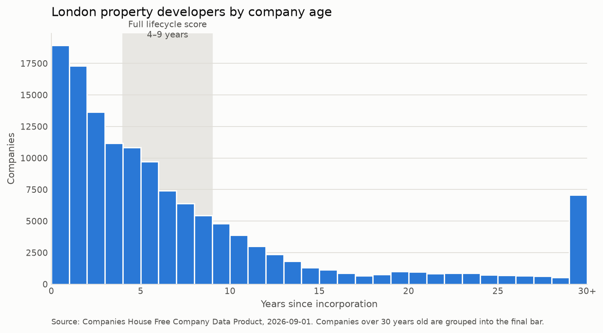

# [WIP 11/10/26] Which 25 UK property developers should a sales team call first?

This project builds a ranked call list from the Companies House public register. It starts with
5.7 million UK companies, filters them down to London property developers, scores each one as a
sales prospect, and ends with three outbound emails to the top three. Each email opens with a fact
about that company taken from the data.

The example client is a company selling land-sourcing and planning software to property
developers, the market that startups like [LandTech](https://land.tech), [Orbital](https://www.orbital.tech/uk) and [Searchland](https://searchland.co.uk/) are in. The scoring
choices below are made for these potential buyers and would be different for others.

There is also an interactive version where you can set the weights yourself. See
[Running it](#running-it).

> **Case study: [Acquirepad UK target accounts](case_studies/acquirepad_uk/).** The same method,
> applied by hand to a different buyer. 27 buyers of UK commercial property were researched from
> public sources for Acquirepad, a Berlin AI-native operating system for real estate, entering the UK. Every score above
> zero carries a source URL. The output is a [one-page target list](case_studies/acquirepad_uk/outputs/acquirepad_uk_targets.pdf)
> with a first move for each firm.

## How the score works

| Component | Weight | What it measures |
|---|---|---|
| **Industry fit** | 35 | How close the company's SIC code is to property development. Graded from 1.0 down to 0.25. |
| **Lifecycle fit** | 25 | Company age. Zero under 2 years, full marks from 4 to 9, falling to zero at 20. |
| **Commercial substance** | 25 | Whether the company is big enough to buy: its accounts type, plus outstanding mortgage charges. |
| **Filing health** | 15 | Whether filings are up to date. Overdue or dormant companies lose points. |

Each component scores between 0 and 1, and the weights add up to 100, so the total is a score out
of 100.

The weights are set by hand. There is no data on which of these companies have bought software, so
there is nothing to train a model on. A hand-weighted score also has the advantage that a sales
team can see why an account ranks where it does and disagree with it.
## Results

| | |
|---|---|
| Companies scanned | 5,689,367 |
| Passed the segment filter | 156,107 |
| Sibling companies merged into their group | 19,565 |
| **Accounts ranked** | **136,542** |
| Distinct scores | 807 |

The segment filter keeps a company if it is active, registered in a London postcode area, and has
at least one of six relevant SIC codes.



**Top 5 accounts:**

| # | Company | Age | Accounts | Live charges | Group size | Score |
|---|---|---|---|---|---|---|
| 1 | Sibner Group Ltd | 4.3 | GROUP | 3 | 2 | 100.0 |
| 2 | DSBL HMO Portfolio Limited | 6.2 | GROUP | 4 | 32 | 100.0 |
| 3 | Kajima Student Housing Limited | 7.4 | FULL | 5 | 16 | 98.4 |
| 4 | Urban&Civic Corby Limited | 8.9 | FULL | 8 | 42 | 98.4 |
| 5 | KHK One Limited | 5.9 | FULL | 4 | 4 | 98.4 |

The full ranking is in [`outputs/scored_segment.csv`](outputs/) and the top 25 is in
[`outputs/top_25.csv`](outputs/).

## Two problems I found in the output

**4,401 companies tied at exactly 100.** The first version scored industry, lifecycle and filing
health only. Those three say whether a company is the right kind of company, but not whether it is
big enough to have a budget, so thousands of companies got full marks and the top 25 was
effectively in alphabetical order. I added commercial substance, which uses the accounts type as a
measure of size and outstanding mortgage charges as a sign of active development. That cut the tie
from 4,401 companies to 2.

**The top of the list was one developer several times over.** `PEARL MK 340`, `PEARL MK 330` and
`PEARL LUTTERWORTH 4400` are all registered at the same Mayfair address. Developers set up a
separate company for each scheme to keep its finance separate, so the register is full of these
special-purpose vehicles (SPVs). An SPV has no staff and no budget, so it is not something you can
sell to. I merged companies that share both the first word of their name and their registered
address, which folded 19,565 companies into their groups. The size of each group turned out to be
useful in its own right: a developer with 42 SPVs is running about 42 schemes.

## Mortgage charges count as a good sign

A mortgage charge is debt secured against a company's assets. Lenders and credit agencies read a
high number of charges as a risk, and on a credit report five outstanding charges is bad news.

This project reads them the other way. Property development is funded by development finance, so
each live charge roughly corresponds to a site being built now. A developer with five live charges
is busy, which makes it a better sales prospect, even though it is also a worse credit risk. A
developer with none is usually dormant, very small, or holding land it is not building on.

The cost of this choice is that an over-leveraged developer close to administration looks the same
as a busy one. Filing health catches the ones that have stopped filing, but a company can be in
trouble and still file on time. The score is for deciding who to call first. It should not be used
to decide whether a customer can pay.

## What I would do with it

Give the top 25 to one rep as a call order, and treat it as a list of leads to work through, not
as qualified pipeline. Open each call with the fact that put the company on the list, such as its
live charges or the number of schemes behind its SPVs. The three emails in notebook 4 do this.

Then record the outcome of every call against the four component scores. After a few weeks those
outcomes are the data on who buys that the project currently lacks, and the weights can be adjusted
to match: more weight for the components that predict a meeting, less for the ones that do not.
Keep credit checks as a separate step, for the reason given above.

## What's in the repo

| File | |
|---|---|
| [`1. data_acquisition.ipynb`](1.%20data_acquisition.ipynb) | The data source, why it uses the bulk file and not the API, and the segment filter |
| [`2. scoring_model.ipynb`](2.%20scoring_model.ipynb) | Each score component, with examples and the reasoning for each boundary |
| [`3. target_list.ipynb`](3.%20target_list.ipynb) | The SPV problem, the chart and the ranked top 25 |
| [`4. outbound_emails.ipynb`](4.%20outbound_emails.ipynb) | The three emails and how each one was written |
| `config.py` | Every targeting decision: SIC codes, postcodes, age boundaries and weights |
| `scoring.py` | The four components as plain functions |
| `get_data.py` | Downloads the register and filters it to the segment |
| `pipeline.py` | Scores, merges groups and ranks |
| `chart.py` | Draws the age distribution chart |
| `app.py` | The interactive ranking |
| `test_scoring.py` · `test_pipeline.py` | 42 tests |

## Running it

You need Python 3.11 or later.

```bash
git clone https://github.com/K-eet/Portfolio_Projects.git
cd "Portfolio_Projects/Ideal Customer Profile project"
python -m venv .venv
source .venv/bin/activate        # Windows: .venv\Scripts\activate
pip install -r requirements.txt
```

### The interactive app

```bash
streamlit run app.py
```

This opens at `http://localhost:8501`. It reads the ranked list already committed in `outputs/`,
so there is nothing to download first. In the app you can:

- move the four weights and watch the call list re-order, with each account's change in rank
  against the default weights
- narrow the list by postcode area, activity and age
- see why any account ranks where it does, and which facts an opening line could use

### Rebuilding the ranking from the register

```bash
python get_data.py     # downloads 493 MB and writes data/segment.csv
python pipeline.py     # scores and ranks, takes a few seconds
python chart.py        # writes outputs/segment_age.png
python -m pytest -q    # runs the tests
```

`get_data.py` only needs running again if you change the segment definition (the SIC codes or the
geography). Changing the weights only needs `pipeline.py`.

## Using it for a different market

The SIC codes, postcode areas, age boundaries and weights are all in `config.py`. To build a target
list for another segment, such as construction technology or general SaaS, edit that file and
re-run `get_data.py`. The code does not need to change, but the reasoning behind each number does,
because the current values are argued for property developers specifically.

## Limitations

1. **No revenue data.** Companies House does not publish turnover for small companies. Size is
   estimated from the accounts type and the number of charges.
2. **Registered address is not trading address.** Many companies use a formation agent or a head
   office as their registered address, so this is a list of developers registered in London, and
   many of them build elsewhere.
3. **SIC codes are self-declared.** Nobody audits them, and a company that changed its business
   years ago may never have updated its entry.

These limits are acceptable for a list that puts 25 plausible names in front of a salesperson in
priority order. They would not be acceptable if the score were used to qualify customers.

---

**Data:** [Companies House Free Company Data Product](https://download.companieshouse.gov.uk/en_output.html),
snapshot `2026-09-01`. It is public and needs no API key. Contains public sector information
licensed under the Open Government Licence v3.0.
